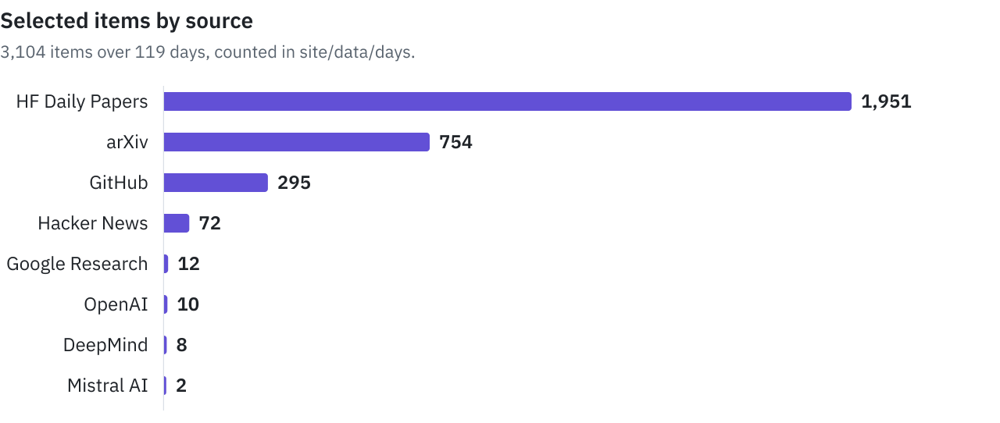

# Veille IA

An automated daily watch on AI research and tools. A Python pipeline collects papers, model releases and projects, the Mistral API filters out the noise and scores what remains, then writes a digest in French. The result is published as a [static site](https://kitoutou999.github.io/VeilleAI/) on GitHub Pages.

<picture>
  <source media="(prefers-color-scheme: dark)" srcset=".github/assets/screenshot-dark.webp">
  
</picture>

## Results

As of 2026-11-04, the pipeline has published every day since 2026-07-09: 119 days and 3,104 selected items, from 8 active sources out of 10 declared.

<picture>
  <source media="(prefers-color-scheme: dark)" srcset=".github/assets/items-by-source-dark.svg">
  
</picture>

## Getting started

```bash
pip install -r requirements.txt

# Test the sources without using the Mistral API
python -m pipeline.run --dry-run

# Full pipeline
export MISTRAL_API_KEY=...
python -m pipeline.run

# Serve the site
python -m http.server 8000 -d site
```

## How it works

| Path | Role |
|---|---|
| `sources.yaml` | Declares the sources, the topics of interest and the settings |
| `pipeline/fetchers.py` | Generic fetching: `rss`, `arxiv`, `hf_papers`, `hackernews`, `github_trending` |
| `pipeline/mistral.py` | Minimal Mistral API client |
| `pipeline/analyze.py` | Scoring, summaries, digest, in-depth analyses |
| `pipeline/run.py` | Orchestrator |
| `site/` | Static site, mobile-first, with a dark mode |
| `site/data/` | JSON generated by the pipeline: `index.json` and `days/YYYY-MM-DD.json` |
| `.github/workflows/veille.yml` | Daily cron: pipeline, commit of the data, Pages deployment |

## Adding a source

Add a block to `sources.yaml`:

```yaml
- name: my-blog
  label: My Blog
  type: rss
  url: https://example.com/feed.xml
  weight: 1        # credibility bonus, 0 to 2
  enabled: true
```

For a new source type, add a `fetch_<type>` function to `pipeline/fetchers.py` and register it in the `FETCHERS` dictionary.

## Settings

In the `settings` section of `sources.yaml`:

| Key | Current value | Role |
|---|---|---|
| `min_relevance` | 5 | Items below this score are dropped |
| `max_items_per_day` | 30 | Maximum size of the daily feed |
| `deep_analysis_count` | 4 | Number of top items analyzed in depth |
| `scoring_model` | `mistral-small-latest` | Model used for scoring |
| `writing_model` | `mistral-large-latest` | Model used for writing |

The `interests` section drives relevance scoring: editing it directly changes what Mistral treats as important.

## Deployment

1. Push the project to the `main` branch of a GitHub repository.
2. In **Settings > Secrets and variables > Actions**, add the `MISTRAL_API_KEY` secret.
3. In **Settings > Pages**, choose **Source: GitHub Actions**.
4. Run the workflow manually from the Actions tab for the first generation.

The pipeline then runs every day at 06:30 UTC and the site updates itself.
